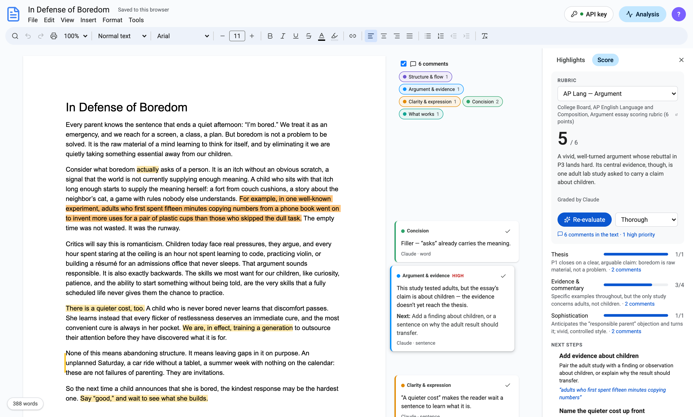
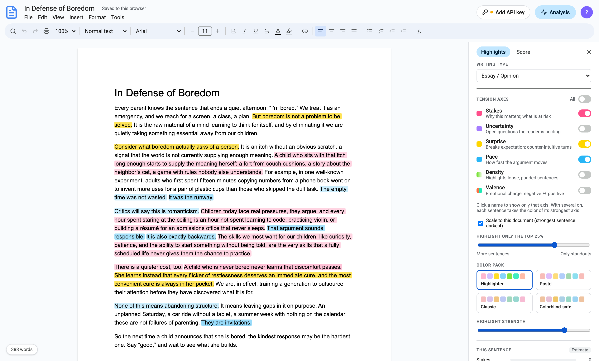
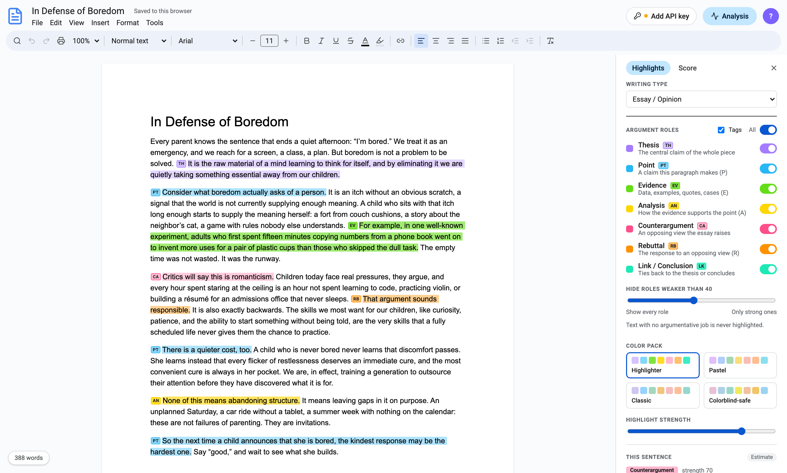
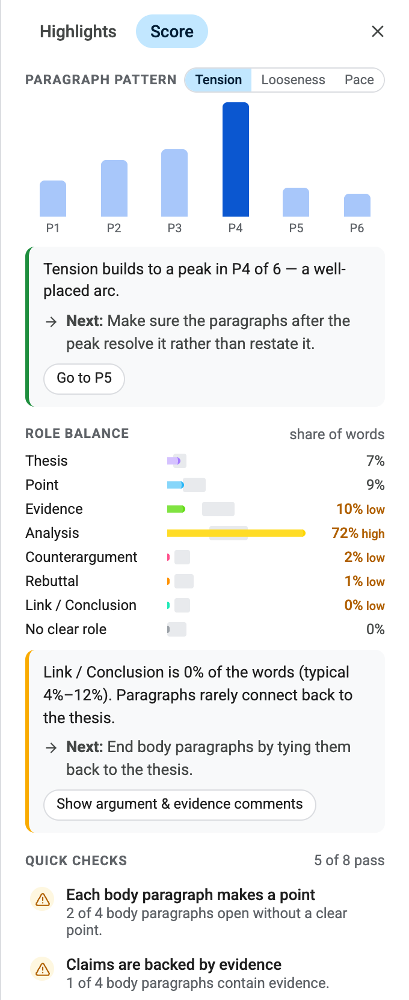
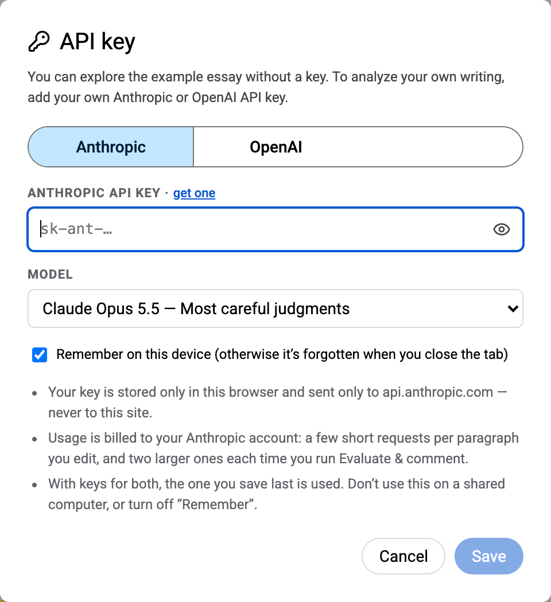

# Tension — a writing editor that shows structure

Tension is a Google Docs–style editor for essays and opinion pieces. It highlights the **tension** and **argument structure** of your writing behind the text. It also leaves **margin comments** the way a teacher would, and grades the draft against an **established rubric**. Every piece of feedback ends with a concrete next step.

**Try it:** https://hanaisreal.github.io/Writer_tool-for-structure/



<sub>Screenshots use the bundled example essay. Highlights come from the no-key local estimates. The comments and grade shown are illustrative examples of the AI output format.</sub>

---

## Contents

1. [Quick start](#quick-start)
2. [The editor](#the-editor)
3. [Analysis panel → Highlights tab](#analysis-panel--highlights-tab)
   - [Tension mode](#tension-mode)
   - [Argument mode](#argument-mode)
   - [Color packs and strength](#color-packs-and-strength)
   - [This sentence](#this-sentence)
4. [Comments in the text](#comments-in-the-text)
5. [Analysis panel → Score tab](#analysis-panel--score-tab)
6. [API keys and privacy](#api-keys-and-privacy)
7. [Local estimates (no key)](#local-estimates-no-key)
8. [Export and print](#export-and-print)
9. [Keyboard shortcuts](#keyboard-shortcuts)
10. [Research behind the feedback design](#research-behind-the-feedback-design)
11. [Running locally](#running-locally)
12. [Project layout](#project-layout)
13. [Known limitations](#known-limitations)

---

## Quick start

1. Open the site. The example essay, *In Defense of Boredom*, is already loaded.
2. Look at the **Analysis** panel on the right. Switch between **Off / Tension / Argument** to see the two kinds of highlights.
3. To analyze your own writing with AI, click **Add API key** (top right) and paste an Anthropic or OpenAI key.
4. Paste or write your essay. Highlights update about 1.2 seconds after you stop typing.
5. Open **Score → Evaluate & comment** for a rubric grade and margin comments.

Your document autosaves in your browser. **File → New document** starts fresh.

---

## The editor

A familiar word-processor layout: title, menu bar, toolbar, and a letter-size page.

| Area | What's there |
| --- | --- |
| **Title** | Click to rename. The name is used for exported files. "Saved to this browser" confirms autosave. |
| **File** | New document; download as PDF, Word (.docx), HTML, or plain text; print. |
| **Edit** | Undo, redo, select all, find and replace. |
| **View** | Show or hide the Analysis panel; switch highlight mode (off, tension, argument). |
| **Insert** | Link, horizontal line, block quote. |
| **Format** | Bold, italic, underline, strikethrough; normal text and headings 1–3; clear formatting. |
| **Tools** | Word count, re-analyze document, API key. |
| **Toolbar** | Search, undo/redo, print, zoom (50–200%), paragraph style, font (Arial, Georgia, Times New Roman, Merriweather, Lora, Roboto, Verdana, Courier New), font size (type a size or use −/+), bold/italic/underline/strike, text color, highlight color, link, alignment, bulleted and numbered lists, indent, clear formatting. |
| **Find & replace** | ⌘F opens it at the top right of the page. Options: match case, next/previous, replace, replace all. |
| **Word count** | The chip at the bottom left shows the live count. Click it (or press ⌘⇧C) for pages, words, characters, and the selection's count. |
| **Panel width** | Drag the left edge of the Analysis panel to resize it. Double-click the edge to reset; arrow keys work when it's focused. |

Analysis highlights and comments are **overlays**. They never change your text, they aren't part of undo, and they don't mix with your own highlight colors.

---

## Analysis panel → Highlights tab

At the top of the panel:

- **Writing type** picks the genre. Essay / Opinion is available now; Fiction is planned.
- **Off / Tension / Argument** picks what is painted behind your text. Only one mode shows at a time.

### Tension mode

Six axes. Each has its own color and on/off switch. Click an axis name to show only that axis; the **All** switch turns every axis on or off.

| Axis | What a high score means |
| --- | --- |
| **Stakes** | The sentence makes the reader feel something important will be won or lost. |
| **Uncertainty** | The reader is left holding an open question: a problem posed, a doubt raised, an objection not yet answered. |
| **Surprise** | The sentence departs from what the reader would predict: a reversal, a counter-intuitive claim, unexpected evidence. |
| **Pace** | The argument moves fast here: short, forceful steps rather than lingering or qualifying. |
| **Density** | *Inverted:* the highlight marks **loose** sentences (filler, hedging, repetition), because those are the ones to fix. |
| **Valence** | Emotional charge. It uses two colors: one for negative (alarm, loss) and one for positive (hope, triumph). |

How the shading works:

- **Only standout sentences are painted.** The default is the **top 25%** per axis. The slider **Highlight only the top …%** ranges from 70% (more sentences) to 5% (only standouts). Everything else stays unhighlighted.
- **Darker = stronger**, among the highlighted sentences.
- **Scale to this document** is on by default. Each axis is ranked *within your essay*, so the shading shows where this essay peaks. Turn it off to shade by absolute score instead. The slider then reads "scores ≥ …".
- **Several axes on:** each sentence takes the color of its strongest axis. Hover a highlight to see which axis and its score.



### Argument mode

Each sentence is split into phrases, and each phrase is labeled with its job in the argument (PEAR style):

| Role | Tag | Meaning |
| --- | --- | --- |
| Thesis | TH | The central claim of the whole piece. |
| Point | PT | A claim a paragraph sets out to support. |
| Evidence | EV | Facts, data, examples, anecdotes, quotations. |
| Analysis | AN | Reasoning that explains how the evidence supports the point. |
| Counterargument | CA | An opposing view, stated so it can be addressed. |
| Rebuttal | RB | The answer to an opposing view: a concession or refutation. |
| Link / Conclusion | LK | Ties back to the thesis, transitions, or concludes. |

- **Text with no argumentative job** (filler, throat-clearing, repetition) is labeled *none* and is **never highlighted**.
- Each phrase also gets a **strength** from 0 to 100: how clearly and effectively it does its job. The slider **Hide roles weaker than …** (default 40) leaves weakly performed roles unpainted. Stronger roles are shaded darker.
- **Tags** toggles the small role tags (TH, EV, …) drawn before each phrase.
- Each role has its own switch, plus an **All** switch. Click a role name to show only that role.



### Color packs and strength

- **Color pack** switches every axis and role color at once. The packs are **Highlighter** (default), **Pastel**, **Classic**, and **Colorblind-safe** (Okabe–Ito).
- Every color is automatically **capped so black text stays readable**. The darkest fill keeps a contrast ratio of about 13:1, well past the WCAG AAA level of 7:1. Dark hues stop early; light hues can go further.
- **Highlight strength** scales opacity *within* that cap, so no setting can bury the text.

### This sentence

Place the cursor in any sentence to see its breakdown at the bottom of the panel:

- In Tension mode, every axis score for that sentence.
- In Argument mode, each phrase's role and strength, marked "below threshold" when it's hidden.
- A one-line note from the AI about what the sentence contributes.
- A badge shows where the data came from: **Claude**, **OpenAI**, or **Estimate** (local rules).

The status line shows whether analysis is up to date. It also offers **Re-analyze** and **Retry**, and asks you to update your key if it was rejected.

---

## Comments in the text

**Score → Evaluate & comment** leaves margin comments beside the page, the way a teacher comments in a shared document.

**Where they attach**

| Scope | How it looks |
| --- | --- |
| Word or phrase | The words get a soft yellow background. |
| Sentence | The sentence gets a soft yellow background. |
| Paragraph | A vertical bar in the left margin of the paragraph. |

**Types** (toggle each one with the chips at the top of the comment column)

| Type | Covers | Order |
| --- | --- | --- |
| Structure & flow | Paragraph focus, order, transitions | Higher-order |
| Argument & evidence | Claims, support, reasoning, counterarguments | Higher-order |
| Clarity & expression | Ambiguity, awkward phrasing, word choice | Sentence-level |
| Concision | Filler, hedging, redundancy | Sentence-level |
| Grammar & mechanics | Grammar, punctuation, spelling, usage | Sentence-level |
| What works | Strengths worth keeping | — |

**Each comment card** shows:

- Its type, and **HIGH** if it's high priority.
- What the AI noticed and why it matters.
- **Next:** the concrete step to take.
- Often a suggested rewrite. **Apply** swaps it in with one click and resolves the comment.
- **✓** resolves the comment without changing the text.
- Who wrote it (Claude, OpenAI, or Auto-check) and its scope.

**Behavior**

- Click commented text, or its card, to open the card. The card lines up with its text, and the other cards move out of the way.
- **Comments follow their text as you edit.** If you delete the commented text, the comment goes with it.
- Comments are saved in your browser with the document.
- **Focused / Thorough** sets how many comments to ask for:
  - **Focused** (default): 4–10, about one per 200 words.
  - **Thorough**: 8–25, about one per 80 words.
  - Fewer, prioritized comments are the default on purpose (see [Research](#research-behind-the-feedback-design)).
- Comments are ordered with higher-order concerns and higher priority first.
- **Without a key**, the button is **Run quick checks**. It leaves a few rule-based comments on very long sentences and common padding ("in order to", "due to the fact that", "it is important to note that", "I think that", intensifiers, "basically/literally/…").

The screenshot at the top of this page shows the comment column: type filters, an open high-priority *Argument & evidence* card with its **Next:** step, and the commented text tinted in the essay.

---

## Analysis panel → Score tab

A concise, holistic view. The detailed feedback lives in the comments.

### Rubric grade

Choose the rubric to grade against. Each has a link to the published source.

| Rubric | Criteria | Scale | Overall |
| --- | --- | --- | --- |
| **AP English Language — Argument** (College Board) | Thesis (0–1), Evidence & commentary (0–4), Sophistication (0–1) | Whole points | Sum, out of 6 |
| **IELTS Writing Task 2** | Task response, Coherence & cohesion, Lexical resource, Grammatical range & accuracy | Bands 0–9, half bands allowed | Mean, rounded to the nearest half band |
| **6+1 Trait Writing** (Education Northwest) | Ideas, Organization, Voice, Word choice, Sentence fluency, Conventions, Presentation | 1–5 | Mean |

After **Evaluate & comment** you get:

- **Overall score** on the rubric's own scale.
- A **two-sentence summary**: the main strength and the single biggest problem.
- **Each criterion's score** with a one-line reason. **N comments** links to the comments that bear on that criterion.
- **Next steps**: the three revisions that would raise the score most, highest impact first. Click the quote to jump to the spot.
- **Graded by …**. If you've edited the essay since, it says the document changed.

AI grades are estimates to guide revision, not official scores.

### Paragraph pattern

A bar per paragraph. Click a bar to jump to that paragraph. Switch the metric:

| Metric | What each bar is |
| --- | --- |
| **Tension** | Average of stakes, uncertainty, and surprise in the paragraph. |
| **Looseness** | Share of the paragraph's sentences that read as loose. |
| **Pace** | Average pace of the paragraph's sentences. |

Under the chart, an **insight** explains what the pattern means for your essay and gives the **next step**. Where it applies, buttons take you there: **Go to P#**, and **Show … comments**, which shows only the relevant comment type. Examples:

- *"Tension peaks early (P2 of 6) and fades… Next: save your sharpest turn for later, or raise the stakes in P5."*
- *"P3 is the loosest: 3 of 5 sentences carry filler… Next: tighten P3 first."*
- *"P4 drags… Next: lead with the claim and split the longest sentence."*

### Role balance

The share of words spent on each argument role. The gray band marks the typical range for an argumentative essay, and values outside it are flagged *low* or *high*:

| Role | Typical share |
| --- | --- |
| Thesis | 3–10% |
| Point | 8–20% |
| Evidence | 18–35% |
| Analysis | 22–42% |
| Counterargument | 4–12% |
| Rebuttal | 4–14% |
| Link / Conclusion | 4–12% |
| No clear role | 0–10% |

The insight below picks the most out-of-range role and says what to do. Example: *"Evidence is 10% of the words (typical 18–35%). Claims outrun their support. Next: add a concrete example in P3."* These ranges are guides, not rules.

### Quick checks

Eight structural checks run instantly. Only failing ones are listed; click one to jump to it.

1. Thesis stated up front
2. Each body paragraph makes a point
3. Claims are backed by evidence (at least half the body paragraphs)
4. Opposing view raised and answered
5. Ending ties back to the thesis
6. Prose is tight (at most 20% loose sentences)
7. Sentence rhythm varies (sentence length varies by at least ±5 words)
8. Tension builds toward a late peak (the peak falls in the second half)

The footer says whether the patterns use AI analysis or local estimates.



---

## API keys and privacy

Click **Add API key** (or **Tools → API key…**).

| Provider | Models offered | Get a key |
| --- | --- | --- |
| **Anthropic** | Claude Opus 5.5 (default), Claude Sonnet 5.5, or any model id | [console.anthropic.com](https://console.anthropic.com/settings/keys) |
| **OpenAI** | GPT-5.5 (default), GPT-5.4 mini, or any model id | [platform.openai.com](https://platform.openai.com/api-keys) |

- **Your key never reaches this site.** The site has no server. The key is stored only in your browser and sent only to its provider (`api.anthropic.com` or `api.openai.com`).
- **Remember on this device** keeps the key after you close the browser. Turn it off to forget the key when the tab closes. Don't leave it on on a shared computer.
- Before saving, the key and model are checked with a **free metadata call**, so typos surface immediately.
- You can store keys for both providers. The one you saved last is used, and each tab shows a ✓ when it has a key.
- Both providers get **the same prompts, rubric, and output format**. Results are credited to whichever produced them.
- **Cost** is billed to your own account. Editing sends a few short requests per changed paragraph. Each **Evaluate & comment** sends two larger requests: one for the grade, one for the comments.



---

## Local estimates (no key)

Without a key, highlights and checks still appear. They come from simple rules that run in your browser, not from AI:

| Signal | Rule |
| --- | --- |
| Pace | Shorter sentences read faster. |
| Density | Filler words ("very", "basically", …) and hedges ("it is important to note that", …) lower it. |
| Surprise | Contrast words ("but", "however", "actually", …). |
| Stakes | Words like "risk", "crisis", "must", "lose", and numbers. |
| Uncertainty | Questions and words like "why", "whether", "perhaps". |
| Argument roles | Cue phrases ("for example" → evidence, "critics say" → counterargument, "therefore" → analysis, "in conclusion" → link) and position (last sentence of the intro → thesis; first sentence of a body paragraph → point). |

Because Tension ranks sentences within your document, the top ones are always painted, even when the estimates are rough. The panel labels these results **Estimate**. With a key, AI results replace them as each paragraph is analyzed.

---

## Export and print

**File → Download as PDF / Word (.docx)** and **Print** each ask:

- **With analysis colors**: the current Tension or Argument highlights (and argument tags), plus a color legend at the end. Exported files get "(tension)" or "(argument)" in the name.
- **Plain**: just your text and formatting.

Notes:

- PDF and Word files contain real, selectable text, not images. Word keeps your fonts. PDF uses Roboto for all text.
- For colored printing, turn on **Background graphics** in the browser's print dialog if colors are missing.
- Comments are not included in exports or printouts.
- **HTML** and **plain text** downloads are also in the File menu.

---

## Keyboard shortcuts

⌘ is Ctrl on Windows and Linux.

| Action | Shortcut |
| --- | --- |
| Bold / Italic / Underline | ⌘B / ⌘I / ⌘U |
| Strikethrough | ⌘⇧S |
| Link | ⌘K |
| Clear formatting | ⌘\ |
| Normal text / Heading 1–3 | ⌘⌥0 / ⌘⌥1–3 |
| Align left / center / right / justify | ⌘⇧L / ⌘⇧E / ⌘⇧R / ⌘⇧J |
| Bulleted / numbered list | ⌘⇧8 / ⌘⇧7 |
| Block quote | ⌘⇧B |
| Undo / Redo | ⌘Z / ⌘⇧Z |
| Find | ⌘F |
| Find and replace | ⌘⇧H |
| Word count | ⌘⇧C |
| Print | ⌘P |

---

## Research behind the feedback design

- **Fewer, prioritized comments.** SEFORA (2026) compared LLM feedback with 8,240 instructor annotations. Producing more comments strongly hurt alignment with instructors (r ≈ −0.85), and supplying feedback categories helped. So comments default to a small **Focused** budget and a fixed set of categories. — [arXiv:2607.00274](https://arxiv.org/html/2607.00274)
- **Higher-order concerns first.** Writing-center practice puts thesis, argument, and organization before sentence-level issues, so comments and next steps are ordered that way. — e.g. [UC Merced Writing Center](https://writingcenter.ucmerced.edu/node/231)
- **Feed-forward.** Hattie & Timperley's feedback model says effective feedback answers "Where to next?" Every comment, chart insight, and next step ends with a concrete action. — [The Power of Feedback (2007)](https://www.researchgate.net/publication/258182775_The_Power_of_Feedback)
- **LLM feedback in practice.** AI feedback has been shown to increase students' revision and motivation. Other comparisons find human feedback more specific and better at targeting the most critical issues. That's why AI grades are presented as estimates. — [ScienceDirect (2023)](https://www.sciencedirect.com/science/article/pii/S2666920X23000784), [EdWorkingPapers](https://edworkingpapers.com/sites/default/files/ai25-1193.pdf)
- **Established rubrics.** Sources: [College Board AP rubric](https://apcentral.collegeboard.org/media/pdf/ap-english-language-and-composition-frqs-1-2-3-scoring-rubrics.pdf), [IELTS public band descriptors](https://assets.ctfassets.net/unrdeg6se4ke/19SJoSvnUYjrHgVhWvuMnC/42f1b0cb0d7709646a1392d8418646d0/writingbanddescriptorstask1and2.pdf), and [Education Northwest 6+1 Trait](https://educationnorthwest.org/resources/61-trait-rubrics). The descriptors in `shared/rubrics.ts` are short paraphrases; the published rubrics remain the authority.

---

## Running locally

```bash
npm install
cp .env.example .env   # optional
npm run dev            # web on http://localhost:5173, API server on :8787
```

Without a `.env`, the local app behaves like the website: you paste a key in the browser. With a `.env`:

| Variable | Purpose |
| --- | --- |
| `ANTHROPIC_API_KEY` | The server calls Claude itself; no browser key is needed. The server supports Anthropic only; OpenAI keys still work from the browser. |
| `ANALYSIS_FORCE_ENABLE` | Set to `1` if you authenticate with `ant auth login` instead of an API key. |
| `ANALYSIS_MODEL` | Model for server-side calls (default `claude-opus-5-5`). |
| `ANALYSIS_EFFORT` | `low` / `medium` / `high` for per-paragraph analysis (default `low`). |
| `EVAL_EFFORT` | `low` / `medium` / `high` for grading and comments (default `medium`). |
| `GOOGLE_CLIENT_ID`, `GOOGLE_CLIENT_SECRET` | Require Google sign-in. Register the redirect URI `http://localhost:5173/auth/google/callback`. |
| `APP_ORIGIN` | Origin used for the OAuth redirect (default `http://localhost:5173`). |
| `SESSION_SECRET` | Signs the session cookie (`openssl rand -hex 32`). |

Other scripts:

| Script | Does |
| --- | --- |
| `npm run build` | Type-check and build. |
| `npm run build:pages` | Static build for GitHub Pages (no server). |
| `npm run typecheck` | Type-check only. |
| `npm run lint` | Lint with oxlint. |

### Baking AI results into the example

So visitors can see real AI results on the example without a key:

1. Run locally with a key and let it analyze the example. Optionally run **Score → Evaluate & comment**.
2. Choose **Tools → Save analysis as site example (dev)**.
3. Put the downloaded `sample-analysis.json` in `public/` and push.

### Deploying

Every push to `main` runs `.github/workflows/pages.yml`, which builds the static site (`npm run build:pages`) and publishes it to GitHub Pages.

---

## Project layout

| Path | What it does |
| --- | --- |
| `shared/genres.ts` | Genre profiles: tension axes, argument roles, role-balance ranges, and API types. Add new genres here. |
| `shared/rubrics.ts` | The established rubrics and how their scores combine. |
| `shared/comments.ts` | Comment categories and types. |
| `shared/prompts.ts` | Provider-neutral prompts, output schemas, and normalization. |
| `shared/claude.ts` | Anthropic calls, used by both the server and the browser. |
| `src/llm/` | Browser key storage, OpenAI calls, and routing between the server and the browser. |
| `src/analysis/segment.ts` | Splits the document into sentences mapped to editor positions. |
| `src/analysis/heuristics.ts` | Local estimates. |
| `src/analysis/highlight.ts` | What to paint (thresholds, ranking, palettes), rendered as ProseMirror decorations. |
| `src/analysis/palettes.ts` | Color packs and the readability cap. |
| `src/analysis/scheduler.ts` | Debounced, incremental, per-paragraph analysis. |
| `src/analysis/evaluate.ts` | Quick checks and role balance. |
| `src/analysis/insights.ts` | What each chart means and the next step. |
| `src/comments/` | The comment plugin (anchors that follow edits), placement, quick checks, and persistence. |
| `src/components/` | Toolbar, menus, Analysis panel (Highlights and Score tabs), comment column, dialogs. |
| `src/export/` | Document → styled runs, then the PDF and Word writers and printing. |
| `server/` | Optional local server: Google OAuth and the server-side Claude key. |

---

## Known limitations

- Only **English essays / opinion pieces** are supported so far. PDF export has no Korean (or other CJK) font.
- When Tension or Argument highlights are on, the yellow comment marks can be hard to see. Turn highlights **Off** while reading comments.
- Undoing an **Apply** restores the text, but not the comment.
- Comments aren't included in PDF, Word, or print.
- AI output can be wrong: a misread role, a mis-scored sentence, or a comment that misses the point. Treat grades and comments as a second reader, not a verdict.
